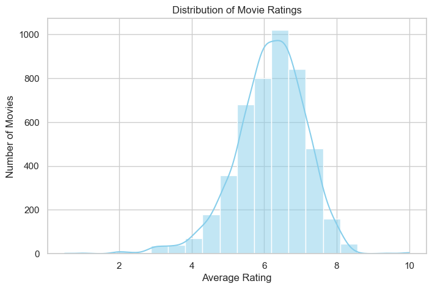

# Movie Success Analysis

**An end-to-end data mining and visualization study of what makes a film succeed.**

This project analyzes a movie metadata dataset (about 4,800 films) to understand which factors - budget, genre, keywords, runtime, popularity - separate high-rated, high-revenue films from the rest.



## Skills demonstrated

- Data cleaning and feature engineering (missing values, pseudo-missing values, date parsing, feature extraction)
- Exploratory data analysis (EDA) with 25+ visualizations
- Unsupervised learning (KMeans clustering) and supervised learning (decision-tree classification)
- Turning model output into interpretable, business-oriented insights

## Key findings

- **Budget does not buy quality.** The budget-rating correlation is weak - more spending does not reliably produce a better film.
- **Audience reach and rating move together.** KMeans (k=2, silhouette ~0.50) splits films into a "blockbuster" cluster (rating ~7.06, ~2,950 votes, popularity ~68.7) and a "low-profile" cluster (rating ~6.04, 344 votes, popularity ~14.4).
- **Theme matters more than scale.** High-rated films skew toward emotionally resonant keywords ("friendship", "biography"); low-rated films skew toward generic or violent keywords.
- **Genres differ in success rate.** Some genres achieve consistently higher ratings and commercial success than others.
- **Pre-release factors barely predict rating.** A decision-tree classifier reaches only ~0.70 cross-validated ROC-AUC, and its signal comes almost entirely from post-release `popularity` (feature importance 0.463) rather than budget or runtime - box-office success and rating are largely post-hoc outcomes, not predictable in advance.

## Pipeline

1. **Data cleaning and feature engineering** - duplicate removal, missing and pseudo-missing values (zeros in budget/revenue), datetime parsing, extraction of JSON-like fields (genres, keywords, countries, languages), and derived features (decade, high-rating label, success flag).
2. **Exploratory data analysis (EDA)** - distributions, year/decade trends, budget-rating and runtime-rating relationships, genre/country/language breakdowns, and a keyword word cloud.
3. **Modelling**
   - Unsupervised: KMeans clustering with silhouette-score selection (k=2) and PCA for visualization.
   - Supervised: a decision-tree classifier (max_depth=4) predicting high-rated films.
4. **Insights** - keyword and genre patterns that distinguish high-rated from low-rated films.

## Tech stack

Python, pandas, NumPy, Matplotlib, Seaborn, scikit-learn, WordCloud

## Data

Movie metadata dataset (about 4,800 films) provided by the course; its original source was not stated. The fields (budget, revenue, genres, keywords, popularity, vote_average, vote_count) are consistent with metadata from The Movie Database (TMDB), a common source for such teaching datasets. If you reuse the raw data, credit the original provider.

## How to run

**View the notebook online (no setup required):** [nbviewer](https://nbviewer.org/github/Ternat/movie-success-analysis/blob/main/movie-success-analysis.ipynb)

```bash
pip install -r requirements.txt
jupyter notebook movie-success-analysis.ipynb
```

## Project structure

- `movie-success-analysis.ipynb` - full analysis notebook (runnable, all outputs included)
- `movies.csv` - raw dataset
- `images/` - charts exported from the notebook

## Language

- [中文版](README.zh-CN.md)
